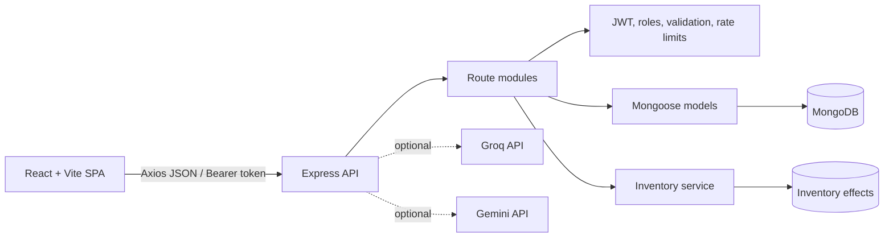

# Architecture and Folder Structure

## Runtime architecture

The frontend stores access and refresh tokens in browser `localStorage`. Axios adds the access token to requests and coordinates one refresh request when an access token expires. The backend exposes REST routes under `/api`, verifies JWTs in middleware, and persists application data through Mongoose.

## Backend structure

| Path | Responsibility |
|---|---|
| `backend/server.js` | Express application factory, route registration, MongoDB connection, production-server entry point. |
| `backend/api/` | Resource-oriented route handlers: auth, users, stores, products, cart, orders, returns, support, and others. |
| `backend/models/` | Mongoose schemas, order state-machine rules, and notification helper. |
| `backend/middleware/` | JWT/role protection, Zod request validation, and auth rate limits. |
| `backend/validation/` | Reusable Zod schemas for authentication, orders, products, and support tickets. |
| `backend/services/inventoryService.js` | Stage 3 transactional inventory primitives and retry helper. |
| `backend/tests/` | `node:test` suites plus isolated replica-set helpers. |

## Frontend structure

| Path | Responsibility |
|---|---|
| `frontend/src/App.jsx` | Client-side route definitions and role-protected pages. |
| `frontend/src/api/axiosInstance.js` | Axios base URL, bearer header, refresh coordination, retry interceptor. |
| `frontend/src/context/` | Auth, cart, and wishlist shared state. |
| `frontend/src/components/` | Common navigation/loading/support UI and product cards. |
| `frontend/src/pages/` | Customer pages and role-specific `admin`, `seller`, `support`, and `delivery` pages. |

## Stage 3 inventory boundary

`InventoryEffectModel` records reserve, commit, release, and restore effects. `inventoryService.js` implements transaction-required operations and seller stock setting. At the current stage only seller product mutations use the service. Checkout, order status transitions, and return/refund routes still contain their earlier direct inventory logic and are documented as future integration work.

## Test architecture

`backend/tests/helpers.js` starts `MongoMemoryReplSet` with one `wiredTiger` node. Tests connect Mongoose only to that memory-server URI, clear collections before tests, and stop the replica set afterward. The normal Express server is not started by tests; tests use `createApp()` through Supertest.
