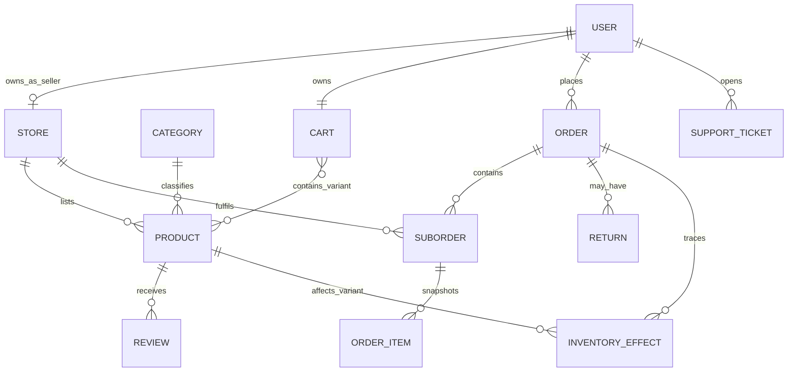

# Data Model and Roles

## Main collections and relationships

## Collection summary

| Collection/model | Important fields and relationships |
|---|---|
| `User` | Name, email, hashed password, role, addresses, refresh tokens, seller/delivery profiles, `mustChangePassword`. |
| `Store` | Seller reference, name/slug, contact data, approval status, activity flag. |
| `Category` | Name/slug and optional parent category. |
| `Product` | Store/category references, title/slug, status, rating values, variants, tags. |
| Product variant (embedded) | SKU, attributes, price, stock, reserved stock, images, active flag. |
| `Cart` | One cart per user; embedded items reference product, variant, and store with quantity/price snapshot. |
| `Order` | Customer, shipping address, payment metadata, and embedded multi-vendor suborders. |
| Suborder/order item (embedded) | Store, snapshot item details, status/history, delivery assignment, tracking/cancellation/return fields. |
| `InventoryEffect` | Stage 3 ledger: effect type, source, order/suborder/product/variant, quantity, and reason. |
| `Return` | Customer return request, store, specific product/variant quantities, workflow status, refund details. |
| `Review` | Product/customer/order references, rating, moderation state, seller reply. |
| `SupportTicket` | Customer, optional assignment/order/return references, messages, category, status. |
| Other models | `Coupon`, `Notification`, and `AuditLog`. |

## Inventory fields

Each embedded product variant uses `stock` and `reservedStock`. Both must be non-negative integers, and model validation requires `reservedStock <= stock`. The available quantity is `stock - reservedStock`.

## Roles and implemented access boundaries

| Role | Confirmed capabilities |
|---|---|
| Customer | Public registration, login, browse products, cart, checkout request, own orders, wishlist, reviews, return request, own support tickets. |
| Seller | Create/update own store, create/update/archive own products, seller dashboard/order/return views, seller stock updates, review replies. |
| Admin | Moderate stores/products, manage categories/users, create seller/support/delivery staff accounts, dashboard, support-ticket assignment/status, audit-log API. |
| Support | Access unassigned or self-assigned support tickets, reply/update allowed ticket status, return-status API access. |
| Delivery | Backend can list assigned suborders using `/api/delivery/my-deliveries`. The current delivery frontend expects additional endpoints that do not exist. |

Public registration always creates a customer. The staff creation endpoint deliberately excludes creation of admin accounts.
