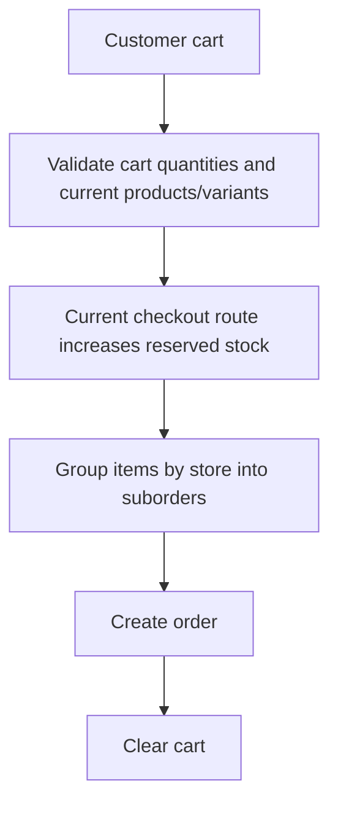
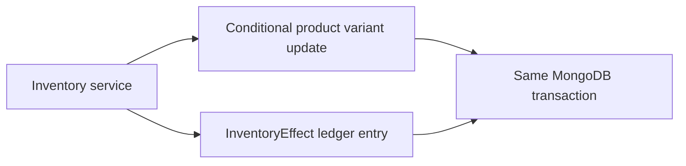

# Commerce and Inventory Workflows

## Current checkout flow

The current checkout route validates address/payment-method input and current availability, creates one order with one suborder per store, and clears the cart after order creation. It supports order payment metadata (`cod`, `card`, `upi`, `netbanking`) only; it does **not** integrate with a real payment gateway.

## Stage 3 inventory infrastructure

The Stage 3 service provides `reserveStock`, `commitReservation`, `releaseReservation`, `restoreStock`, and `setSellerStock`. It uses transaction sessions, conditional variant updates, and a unique inventory-effect ledger to support retries and avoid duplicated effects. Seller product-edit and stock-update routes use `setSellerStock`.

## Important current boundary

The following routes are **not yet integrated** with the Stage 3 service:

- `POST /api/orders/checkout`
- `PATCH /api/orders/:id/suborders/:subOrderId/status`
- `PATCH /api/returns/:id/status`

Consequently, transactional checkout, checkout idempotency, transactional order transitions, legacy-order reconciliation, and transactional return/refund restocking remain future work.

## Order statuses

The order state machine defines: `placed → confirmed → packed → shipped → delivered`, with cancellation allowed from `placed`, `confirmed`, and `packed`, and `delivered → returned → refunded` for the return branch. The current role/transition implementation should be demonstrated only after preflight testing with demo data.

## Seller stock safeguards

Product variants require non-negative integer stock and reservations. Seller payloads cannot set `reservedStock`; stock cannot be lowered below it. Existing variant IDs are retained during edits, and variants with held reservations cannot be removed.
